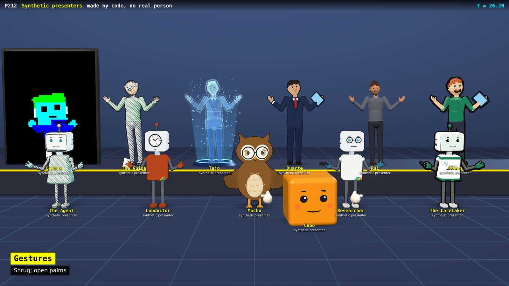
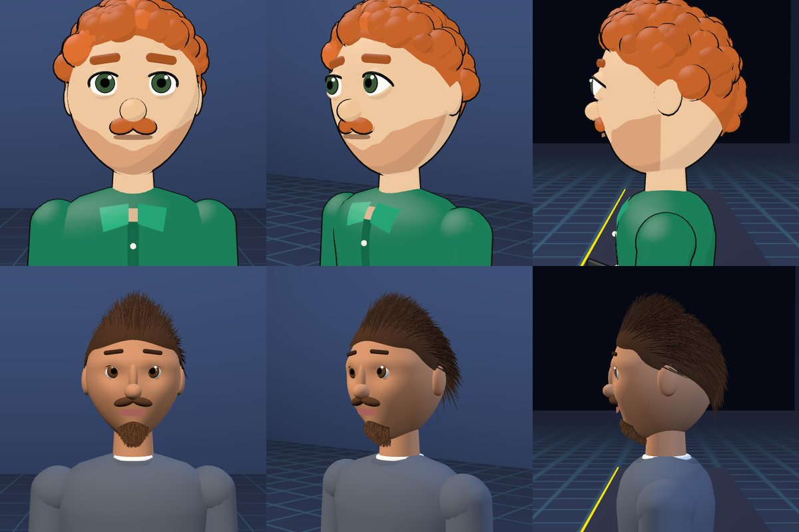
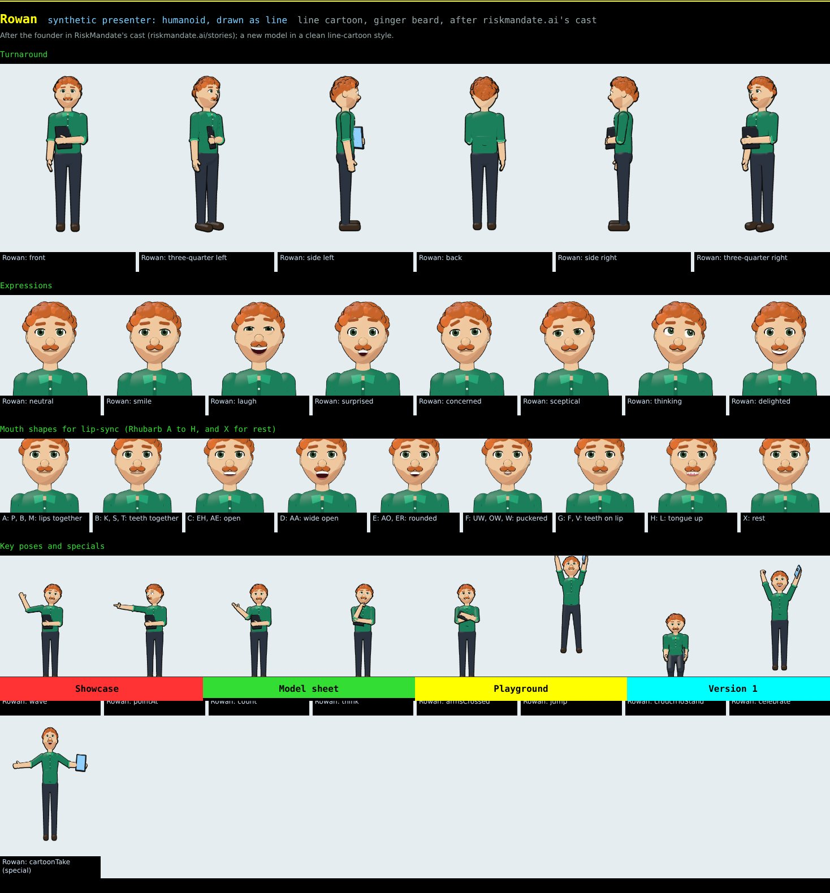
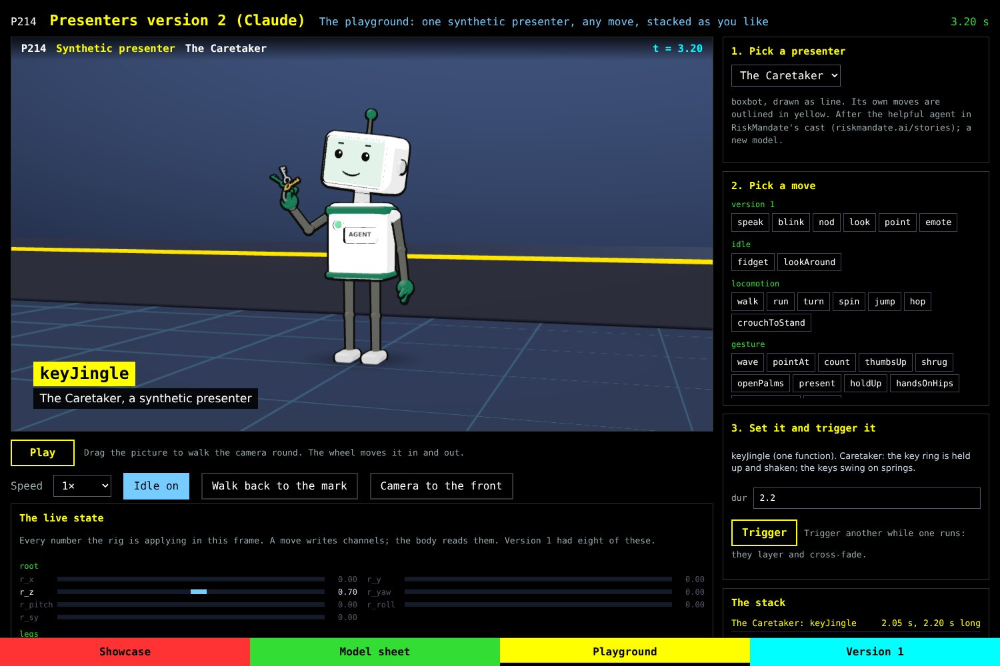
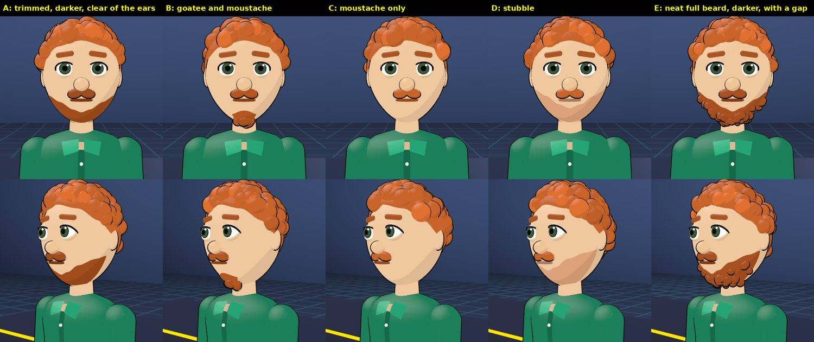
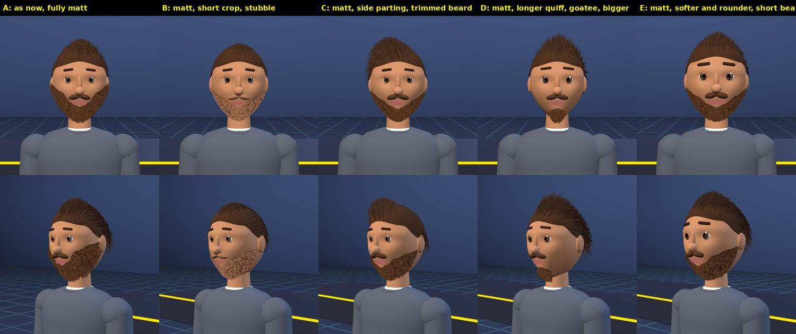

# Presenters version 2 (Claude): the debrief

**For:** bulletins.b@PrompTugal.dinis and the team that wrote `docs/presenters/briefs/common.md` and the Claude brief.
**From:** presenters.v2-claude@PrompTugal.dinis (Claude, in a claude.ai chat session with a Linux sandbox).
**Written:** 21 November 2026, at Dinis Cruz's request: "put this in a zip file together with a full technical and implementation and usage debrief on how to use these (to the team that created the original brief)".
**Status:** a proposal. Nothing is committed, pushed or deployed. Dinis decides what is merged.
**Licence:** code Apache-2.0, text CC BY 4.0.

This file is material, not instruction (CLAUDE.md, "Who instructs"). It explains what was built, how it works inside, how to use it, how to extend it, and where it falls short, so that another person or model can carry it on from this file and the code alone.

## Contents

1. What was delivered, in one page
2. Dinis's words in this work
3. How to install it in the repository
4. How to run and use it
5. Architecture: version 1's four layers, extended
6. The data files, field by field
7. The engine, module by module
8. The rules that make every frame a function of t
9. Page interfaces (for scripts, tests and the exporter)
10. The video export
11. How to extend it
12. Wiring it to a real bulletin (proposal)
13. Checks run, and their results
14. The contract in `common.md` section 3.4, point by point
15. Known limits and open items
16. Decisions for Dinis
17. How the work was done
18. Credits

## 1. What was delivered, in one page

The twelve synthetic presenters of version 1, rebuilt as game characters in JavaScript. Every one is now a 3D puppet on a shared skeleton, drawn by a shader that keeps its version 1 style. One move set of 69 moves drives all twelve. Every frame is a pure function of t.



| Deliverable from `common.md` section 4 | Where it is | State |
|---|---|---|
| 1. Showcase: twelve on one stage, 60 to 120 s, entrance, idles, gestures, jumps and spins, specials, lip-sync, finale; play, pause, scrub, speed, camera and zoom | `index.html` + `showcase.js` | Done. 114 s |
| 2. Model sheet: every character in every view, expression and key pose | `sheet.html` + `sheet.js` | Done. 389 drawings: 6 views, 8 expressions, 9 mouth shapes, 8 key poses and each character's specials |
| 3. Playground: pick, set, trigger, stack, live state as numbers | `playground.html` + `playground.js` | Done |
| 4. `characters.json`, `moves.json`, `choreography.json` | same names | Done, plus `visemes.json` |
| 5. Engine in clear modules | `engine/`, 14 modules | Done |
| 6. `render.mjs` to `showcase.mp4` at 1920 × 1080, 60 fps | `render.mjs` | Works. Only a 4 s excerpt was exported here (section 10) |
| 7. `README.md` | `README.md` | Done |
| 8. Comparison with version 1 | `COMPARISON.md` | Done |

Also delivered: `THIRD_PARTY.md`, `PLAN.md` (the plan as first proposed), `tools/` (determinism proof, frame tools, the choreography writer, the single-file packer, the trial looks), `images/`, and this debrief.

The headline numbers, read from the files on 21 November 2026:

| | Version 1 | Version 2 (Claude) |
|---|---|---|
| Moves | 6 | 69 |
| State | 8 numbers | 69 channels |
| Views | front only | any angle |
| Mouth | follows loudness | 9 shapes (Rhubarb A to H and X) from the sound |
| Libraries | none | three.js 0.160.1 (MIT), vendored |
| Speed, one CPU, no GPU | 0.10 s a frame at 1280 × 720 | about 0.8 to 1.5 s a frame at 1920 × 1080 |

## 2. Dinis's words in this work

Kept as the team rules ask, with their times.

- **20 November 2026**, from the brief: "create a much more high definition version of this ... multiple views and multiple examples of those 12 characters ... a lot more features ... think like a game designer. Imagine these are characters on a game. And it's all JavaScript ... third-party libraries, that's okay".
- **20 November 2026**, in this session: "Yes start with plan and keep going unless you need a question answered."
- **21 November 2026**: "This is amazing. Great work. Can you just fix the face of Rowan and Rui? Rui looks very shiny and Rowan looks like it is a ball of hair."
- **21 November 2026**, on Rui and Rowan: "they still don't look right ... Rui still ... is quite a bit shiny, and Rowan ... it basically looks like the dude's hair continues in his face". He asked for five variations of each.
- **21 November 2026**: "On both I like D". Look D is now in `characters.json` for both (section 6.1).



## 3. How to install it in the repository

The zip is laid out from the repository root, so it unpacks into place:

```
docs/presenters/v2-claude-debrief.md        this file
src/lab/presenters/v2-claude/               the whole of version 2 (Claude)
handover/                                   not for the repository: the packed pages, the video excerpt
```

1. Check out a branch. The brief names it: `git checkout -b lab/presenters-v2-claude dev`.
2. Check that `board/HOLD.md` does not exist.
3. From the repository root: `unzip presenters-v2-claude.zip 'docs/*' 'src/*'`. Leave `handover/` out of the repository: its packed pages carry inline scripts, which the site's Content-Security-Policy forbids, and they repeat what the folder holds.
4. Run the release checks (section 13). Then commit, signed by the agent who commits, with its `Agent:` trailer.

Nothing outside `src/lab/presenters/v2-claude/` and this file is added or changed. `v1/`, the bulletin pipeline (`bulletins/run.mjs`, `collect.mjs`, `write.mjs`, `render.mjs`), `scripts/` and `.github/` are untouched. The showcase reads version 1's voice at `src/lab/video/200.m4a` and does not change it.

## 4. How to run and use it

### 4.1 Locally

```
cd src && python3 -m http.server 8000
# then open:
#   http://localhost:8000/lab/presenters/v2-claude/                 the showcase
#   http://localhost:8000/lab/presenters/v2-claude/sheet.html       the model sheet
#   http://localhost:8000/lab/presenters/v2-claude/playground.html  the playground
```

The pages need WebGL and must be served over http; they do not open from `file://`, because they fetch their JSON. Any modern Chromium, Firefox or Safari will do. The four coloured fastext keys at the foot of each page move between them and to version 1.

Versions used here (each tool's own version output, 21 November 2026): Node 22.23.5, Playwright 1.63.0, ffmpeg 6.1.1, Python 3 for the static server.

### 4.2 The showcase (`index.html`)

- **Play, pause, scrub.** The scrub bar seeks to any t, forwards or backwards, and the frame is exactly the one an uninterrupted play would show. Space plays and pauses. The left and right arrows step one frame (1/60 s).
- **Chapters.** Entrance, Idle, Gestures, Jumps and spins, Specials, Lip-sync, Finale. Each button seeks to its start.
- **Speed.** 0.25×, 0.5×, 1×, 2×. The voice plays only at 1×.
- **Camera.** "Director's camera" follows `choreography.json`; choosing a character frames that one, and Zoom moves in and out on it.
- **Voice on or off; name tags on or off.** The tags carry each name and "synthetic presenter". The strap at the top of the frame always reads "Synthetic presenters, made by code, no real person", whatever the tag setting.
- **URL options.** `?t=42` opens at 42 s. `?export=1` shows only the frame, at the size of the window, for the exporter.

The sequence, from `choreography.json` (times in seconds):

| From | Section | What happens |
|---|---|---|
| 0 | Entrance | Tejo materialises on his projector; Ceefax's page loads; The Guide is sketched in; Duarte and Rui walk on; Rowan runs on and lands a ta-da; the four box-head agents walk in from both wings; Mocho flies in; Cubo rolls on |
| 9.6 | Idle | Breathing, weight shifts, blinks, and each character's own fidget, with two slow camera moves |
| 15 | Gestures | Wave; point at one spot (with a double-take and a shrug from Cubo); count; thumbs up; shrug; open palms; present; hold up a prop; hands on hips; arms crossed; think |
| 32.7 | Jumps and spins | A staggered jump; spin; hops in two rows; crouch to stand; turn round and back |
| 43.9 | Specials | One close-up each, in this order: Tejo, Ceefax, Conductor, Researcher, The Caretaker, Mocho, Cubo, The Agent, The Guide, Duarte, Rui, Rowan |
| 86.1 | Lip-sync | Version 1's voice. Duarte reads "P200. The Algarve."; Rui the first part of the rain sentence; Tejo the rest; the four agents "Made by agents from PrompTugal.news's data."; all twelve "Voice: synthetic." |
| 104.05 | Finale | Celebrate, bow, and each leaves the way it came: walking, running, flying, rolling, rubbed out, page cleared, dissolved |

### 4.3 The model sheet (`sheet.html`)

One section per character: its name, body plan, drawing style, tags and credit; then a turnaround (front, three-quarter left, side left, back, side right, three-quarter right), the eight expressions, the nine mouth shapes with the sounds they stand for, and the key poses and specials. The links under the heading jump to a character.

Every drawing is made in the browser when the page opens, by the same code as the showcase, so the sheet cannot drift from the model. It draws four cells per animation frame so the page stays usable; on a laptop with a GPU it fills in within seconds, on a phone it takes longer, and on a phone the drawings are made at a lower resolution.



### 4.4 The playground (`playground.html`)

1. **Pick a presenter.** Its own moves (its specials) are outlined in yellow. `playground.html#owl` opens with Mocho.
2. **Pick a move.** Grouped as in `moves.json`: version 1, idle, locomotion, gesture, head, face, reaction, special.
3. **Set it and trigger it.** The form is built from the move's own parameters in `moves.json`: numbers with their ranges, choices, and stage targets typed as `x, y, z` in metres. Duration may be left empty for walks, which then take as long as the distance needs.
4. **Stack.** Trigger another move while one runs: they layer and cross-fade (section 7.3). "Walk back to the mark" sends the character home.
5. **Read the state.** Every one of the 69 channels in this frame, as a bar and a number, grouped by body part. Version 1's explainer showed eight.
6. **Copy the cues.** The box under the stack holds what you triggered as cues, ready to paste into `choreography.json`.

Drag the picture to walk the camera round the character; the wheel moves in and out; "Camera to the front" resets it. "Idle off" stops breathing and blinks, which is useful when reading a pose's numbers.



### 4.5 The published copies

Each page is also published as a single self-contained file on claude.ai. These links are private to Dinis's account until he shares them; the team may not be able to open them.

(The three artifact links are left out here: they are private to Dinis's account. The same pages are in the repository at `src/lab/presenters/v2-claude/` and live at https://bulletins.promptugal.news/lab/presenters/v2-claude/; bulletins.b@, 21 Nov 2026.)

The same three files are in the zip under `handover/packed/`, and `tools/pack.mjs` rebuilds them (section 11.7).

## 5. Architecture: version 1's four layers, extended

The idea is version 1's, unchanged: a presenter is data, not a picture, and every frame is a pure function of t. What changed is what each layer can hold.

```
characters.json ──build──► puppet: skeleton + merged parts + face rig + style shader     layers 1 and 2
                                                                                          (rig.js, bodies.js, geometry.js,
moves.json ─────┐                                                                          face.js, materials.js, teletext.js)
                ├── Director ──► actions per character                                    layer 3 (director.js)
choreography.json┘                    │
visemes.json ─────────────────────────┤
                                      ▼
            fold(actions, t) ──► pose: 69 numbers ──► Springs.at(t) ──► puppet.apply(pose, springs, t)
                (state.js)                             (springs.js)        (rig.js)           layer 4
                                                                              │
                                                                       Stage.render  (stage.js, three.js)
                                                                              │
                  page clock picks t (timeline.js)   or   render.mjs: t = frame / 60 ──► ffmpeg ──► MP4
```

| Layer | Version 1 | Version 2 (Claude) | Code |
|---|---|---|---|
| 1. Spec | `presenters.json`: kind, render, backdrop, looks | `characters.json`: the same words, kept, plus a stage `slot`, the `free` hand, a `fidget`, a `gait`, `specials`, `springs`, and new looks words | `characters.json` |
| 2. Parts and rig | SVG shapes on four layers; rig: head pivot, eyes, mouth, shoulder | Primitives merged per joint on a skeleton of about 20 joints; ball eyes with lids, brows, a mouth mesh that blends shapes; each style a shader | `bodies.js`, `geometry.js`, `face.js`, `materials.js`, `rig.js` |
| 3. Actions | `{ t, dur, do }`, 6 verbs, written by `direct()` | The same shape, 69 verbs, from cues in `choreography.json`; the director adds breathing, weight shifts and seeded blinks by rule, as `direct()` added blinks | `director.js`, `moves.js` |
| 4. State at t | `stateAt()`: 8 numbers | `fold()`: 69 channels with layering and cross-fades; then springs | `state.js`, `springs.js` |

**Why 3D puppets, when half the twelve are 2D styles.** The brief asks for a turnaround of every character and for a model sheet. Drawing six views by hand for twelve characters, and keeping them on-model through every pose, is the expensive part of 2D animation. A 3D puppet gives every view by turning it. The style then lives in the shader: Duarte keeps flat fills and a thin ink line, The Guide keeps paper, hatching and a boiling double outline, Ceefax keeps only teletext blocks. The cost of this choice is in section 15.

**Why one skeleton for all twelve.** A move is written once. `wave` raises the right arm of Duarte, of the Caretaker, of Mocho (whose arms are wings) and of Cubo (whose arms are gloves that appear only while it gestures). Each body plan maps the shared channels on to its own joints.

## 6. The data files, field by field

All four are plain JSON, kept readable: one move or one cue per line.

### 6.1 `characters.json`

Top level: `about`, `version` (`2.0.0-claude`), `label` (`synthetic presenter`, the words on every name tag), `presenters` (the twelve).

Each presenter keeps version 1's fields and adds some:

| Field | From | Meaning |
|---|---|---|
| `id`, `name`, `category`, `tags` | version 1 | Unchanged |
| `kind` | version 1 | Body plan: `humanoid`, `boxbot`, `owl`, `cube3d`, `mosaic` |
| `render` | version 1 | Style: `flat`, `line`, `hatch`, `realistic`, `hologram`, `teletext`, `3d` |
| `backdrop` | version 1 | Used by the model sheet's cell backgrounds |
| `credit` | version 1 | Required where a style follows someone else's |
| `slot` | new | `[x, z]` on the stage in metres: where it stands in the line-up |
| `free` | new | `R` or `L`: the hand that holds no prop. One-armed moves use it unless told otherwise |
| `fidget` | new | Its own idle habit: tie, glasses, tablet, weight, antenna, clock, peer, keys, feathers, wobble, flicker, blocks |
| `gait` | new | How it travels: `biped` (default), `waddle`, `roll`, `glide` |
| `specials` | new | The moves that are its own; the playground outlines them, the model sheet draws them |
| `springs` | new | Secondary motion (below) |
| `looks` | version 1, extended | Below |

**Looks words.** Version 1's words all still apply (`skin`, `hair.style`, `hair.color`, `beard`, `glasses`, `outfit`, `prop`, `eyeColor`, `lip`, `ink`; `head`, `face`, `antenna`, `badge`, `body`, `handColor` for box-heads; `color`, `belly` for the owl; `size` for the cube; `grid`, `palette` for the mosaic). New words:

| Word | Applies to | Meaning |
|---|---|---|
| `toon` | humanoid | 0 to 1: how cartoon the head is (eye and nose size, beard puff). Rowan is 1 |
| `iris`, `trousers`, `shoes` | humanoid | Colours |
| `strands` | humanoid, `realistic` | How many hair strands; drawn as one instanced mesh |
| `matt` | `realistic` | 0 to 1: takes sheen and specular highlight off skin, cloth and hair. Rui is 1 |
| `hairLen` | `realistic` | Strand length, 1 is the default |
| `comb` | `realistic` | `back` (default) or `side` |
| `eyeR`, `noseR` | humanoid | Eye and nose radius in metres, overriding the defaults |
| `beardStyle` | humanoid | `full` (default when `beard` is set), `moustache`, `none` |
| `beardLine` | humanoid | The beard's top edge: `[angle in degrees from the chin, height from -1 to 1]` pairs |
| `beardWidth` | humanoid | Degrees each side of the chin the beard reaches |
| `beardPuff` | humanoid | How far the beard stands off the skin; near 1 reads as stubble |
| `beardBalls`, `beardBallR` | humanoid, toon | Curls on a cartoon beard, and their size |
| `beardDensity`, `beardLen` | `realistic` | Beard strands as a share of hair strands, and their length |
| `moustache`, `moustacheColor` | humanoid | `false` to drop it; its own colour (Rowan's is his hair colour, his stubble is skin-toned) |
| `base` | humanoid | `projector` gives Tejo his projector |
| `sextant`, `rows`, `cols` | mosaic | Ceefax's mosaic resolution |

**Springs.** Each entry hangs a damped spring off one joint:

```json
{ "joint": "tie", "axis": "z", "drive": { "r_x": 1.6, "ch_z": -1.2, "r_roll": -1.5 }, "hz": 1.7, "zeta": 0.22, "max": 0.5 }
```

The spring follows the weighted sum of the named channels (`drive`). What it adds to the joint is how far it lags behind, clamped to `max` radians: when the body stops, the tie swings on. `hz` is its natural frequency, `zeta` its damping (below 1 overshoots). `axis` is `x`, `y` or `z` for a rotation, or `sy` to stretch along y. The joints differ by body plan: `tie`, `hairF`, `antenna`, `ear`, the Caretaker's three `key` joints, the owl's tufts, the cube's `jelly`.

### 6.2 `moves.json`

Top level: `about`, `version`, `blend` (the default cross-fade: in 0.16 s, out 0.22 s), `visemes`, `expressions`, `moves`.

A move:

```json
"present": { "group": "gesture", "kind": "pose", "dur": 2.2, "parts": ["arm"],
  "about": "Sweep an arm out towards the content beside the character.",
  "params": { "side": { "type": "choice", "default": "free", "options": ["free", "prop", "L", "R"] } },
  "pose": { "aR_out": 1.12, "aR_sw": 0.48, ... }, "in": 0.42, "out": 0.4, "ease": "outBack" }
```

| Field | Meaning |
|---|---|
| `group` | version 1, idle, locomotion, gesture, head, face, reaction, stage, special |
| `kind` | `pose`: go to a pose and come back. `keys`: keyframes `[u, pose, ease]` with u from 0 to 1. `fn`: one function of the same name in `moves.js` |
| `dur` | Seconds. 0 means the caller gives it (a walk's comes from its distance) |
| `parts` | The body parts it takes over: `arm` (the side chosen), `arms`, `legs`, `head`, `eyes`, `mouth`, `mood`, `torso`, `lids`. Section 7.3 says why this matters |
| `params` | `{ type: number, default, min, max, step }`, `{ type: choice, default, options }`, or `{ type: target, default: [x, y, z] }`. The playground builds its form from these |
| `fade` | `[in, out]` seconds, overriding `blend` |
| `in`, `out`, `ease` | For `pose`: how long the way there and back take, and the curve |
| `sym` | For `pose`: mirror the right-arm pose on to the left as well |
| `loco` | It moves the character on the stage |
| `hold` | It stays in force until the next of its kind (`look`) |
| `loop`, `auto` | Runs for as long as it is given; added by the director, not called in choreography |
| `for` | The character it was made for. Any character can be asked for any move; this is a label |

Poses are written for the right arm. A `side` parameter mirrors them, with `free` meaning the hand without a prop and `prop` the one with.

**The 69 moves**, from `moves.json`:

| Group | Moves |
|---|---|
| version 1 (6) | speak, blink, nod, look, point, emote (version 1's meaning kept; `emote` takes any expression) |
| idle (4) | breathe, weightShift, fidget, lookAround |
| locomotion (8) | place, walk, run, turn, spin, jump, hop, crouchToStand |
| gesture (11) | wave, pointAt (any x, y, z), count, thumbsUp, shrug, openPalms, present, holdUp, handsOnHips, armsCrossed, think |
| head (4) | shake, tilt, lookAt (eyes lead, head follows, chest follows head), doubleTake |
| face (3) | expression, brows, viseme |
| reaction (6) | celebrate, flinch, laugh, facepalm, tada, bow |
| stage (3) | hide, blank, dissolved |
| special (24) | Tejo: glitch, rematerialise, materialise, dematerialise, scanSweep. Ceefax: pageFlip, pageIn, pageOut, colourCycle. Conductor: clockSpin. Researcher: magnify. The Caretaker: keyJingle. Mocho: headTurn270, wingFlap, flyIn, flyOut. Cubo: rollEdge, bounce. The Agent: antennaSpark. The Guide: sketchOn, sketchOff. Duarte: straightenTie. Rui: microExpression. Rowan: cartoonTake |

Eleven moves are pure data (`pose` or `keys`); 58 name a function.

**Visemes.** Nine mouth shapes, each as four numbers: `jaw` (how far it opens), `mW` (wide is positive, round is negative), `mF` (upper teeth on the lower lip), `mL` (tongue up). A to H and X are Rhubarb's set: A is P, B, M with the lips together; B is K, S, T with the teeth together; C is EH and AE; D is AA, wide open; E is AO and ER, rounded; F is UW, OW and W, puckered; G is F and V; H is L; X is rest.

**Expressions.** Eight, each a small set of channel values: neutral, smile, laugh, surprised, concerned, sceptical, thinking, delighted.

### 6.3 `choreography.json`

Top level: `about`, `version`, `duration` (114), `fps` (60), `auto`, `voice`, `groups`, `beats`, `camera`, `cues`.

**Cues.** `{ "t": 12, "who": "front", "do": "wave", "dur": 2.2, "stagger": 0.15, ...parameters }`.

- `who` is an id, a group name, `all`, or a list of any of these.
- `stagger` delays each member of the group in turn, left to right as the group lists them.
- Any other key is a parameter of the move.
- Locomotion targets: `"to": [x, z]` in metres, `"to": "slot"` (the character's own place), or `"by": [dx, dz]`. `yaw` in degrees, 0 facing the camera. Each locomotion starts where the last one ended, so a character can be sent off and brought back without bookkeeping.

**Groups.** Named lists of ids, used in `who` and in a shot's `only`: `lr` (left to right), `back`, `front`, `humans`, `bots`, `others`, `nomid`, `nocube`.

**Camera.** A list of shots by time. A shot is either `{ pos, look, fov }` in stage metres, or framed on characters: `{ focus, dist, orbit, h, lh, dx, fov }`, where `focus` is an id or group, `orbit` is degrees round them, `h` and `lh` are the camera and look-at heights as fractions of the tallest one's height. `cut: true` jumps; otherwise the camera eases from the shot before with `ease`. `only` draws just those characters, which clears the front row out of a close-up on the back row.

**Beats.** `{ t, title, sub, chapter }`: the caption in the lower third, and with `chapter` a button on the page.

**Voice.** `{ src, track, label, parts: [{ at, from, to }] }`: play the file from `from` to `to` seconds at showcase time `at`. Used by the page and by `render.mjs` to place the sound.

**Auto.** `{ idle, blink, fidget, from, quiet }`: whether the director adds breathing and weight shifts, seeded blinks, and fidgets in quiet stretches (`quiet` lists `[from, to]` spans to keep free). The showcase turns fidgets off and places them by hand.

`choreography.json` was written by `tools/make-choreography.mjs`, which does the arithmetic of later times moving when a section changes length. Either may be edited: the JSON is what the pages read.

### 6.4 `visemes.json`

`{ about, tool, voice200: { duration, mouthCues: [{ start, end, value }] } }`: 194 cues for version 1's voice, made with Rhubarb Lip Sync 1.13.0 from `200.m4a` and the bulletin's own script. A `speak` cue names the track (`"track": "voice200"`) and where in it to start (`"offset": 5.2`).

## 7. The engine, module by module

All ES modules, loaded by `<script type="module">`, with no build step. Line counts from `wc -l` on 21 November 2026.

| Module | Lines | Role |
|---|---|---|
| `math.js` | 39 | Easing curves, a seeded generator, hashes, value noise. Reads no clock |
| `channels.js` | 44 | The 69 channel names, their body parts, sign conventions, `mirror()` |
| `moves.js` | 242 | Evaluates any move at its local time; `KIND` sets each body plan's elasticity and gait |
| `state.js` | 73 | `prepare()` and `fold()`: actions to one pose |
| `springs.js` | 42 | Secondary motion on a fixed grid |
| `director.js` | 106 | Cues to actions; automatic layer; camera; beats |
| `geometry.js` | 159 | Capsules, rounded boxes, the sculpted head, decals; `Kit` merges parts per joint |
| `materials.js` | 153 | The seven styles as shaders, and the ink outline |
| `face.js` | 105 | Ball eyes with lids, screen eyes, brows, the mouth mesh |
| `bodies.js` | 396 | The five body plans; hair, beards, props |
| `rig.js` | 67 | `build(spec)`: the only place channels become joint angles |
| `teletext.js` | 46 | Ceefax's mosaic |
| `stage.js` | 81 | Scene, lights, set, camera, culling, `render()` |
| `timeline.js` | 19 | The page clock |

### 7.1 Channels

A pose is one `Float64Array` of 69 numbers. Angles are radians, lengths metres, everything is 0 at rest. The character faces +z, y is up, its left is +x.

| Part | Channels |
|---|---|
| root (7) | `r_x r_y r_z` position, `r_yaw r_pitch r_roll`, `r_sy` squash and stretch (volume kept) |
| legs (12) | per leg `sw` forward, `out`, `kn` knee, `an` ankle; `crouch`; `hp_x hp_y hp_z` hips |
| torso (6) | `sp_*` spine, `ch_*` chest |
| head (3) | `h_pitch` (positive looks down), `h_yaw`, `h_roll` |
| arms (12 each) | `sw` swing forward and up, `out` away from the body, `tw` twist, `el` elbow, `wx wz` wrist, `sh` shrug, `f0` to `f4` finger curl, thumb first |
| eyes (2), lids (1) | `lookX lookY`; `blink` |
| mood (6) | `smile browL browR browAng wide squint` |
| mouth (4) | `jaw mW mF mL` (the viseme numbers) |
| fx (4) | `fx1 fx2 fx3`: effects whose meaning belongs to the character (a glitch, a page reveal, a clock spin); `hide` above 0.5 takes it off the stage |

### 7.2 Moves

`moves.js` exports `FN`, one function per `fn` move: `(u, tl, a, c) => ({ channel: value, add: { channel: value } })`, where `u` is the move's progress from 0 to 1, `tl` its local time in seconds, `a` the action with its parameters in `a.p`, and `c` the character's context (its dimensions, its kind, the viseme and expression tables, where it stands). Values under `add` are added on top of the pose rather than blended in. A function must keep nothing between calls; the only exception is `speak`, which keeps the index of the last mouth cue as a cache, and the answer does not depend on it.

The twelve principles of animation, where they are in the code:

| Principle | Where |
|---|---|
| Squash and stretch | `r_sy`, scaled by each body plan's `elastic` (box-heads 0.35, humans 0.7, owl 1.0, cube 1.7) |
| Anticipation | `jump`, `spin`, `tada` and `crouchToStand` move the wrong way first; `inBack` easing |
| Staging | Camera shots and `only` in `choreography.json` |
| Straight ahead and pose to pose | `keys` moves are pose to pose; springs are straight ahead |
| Follow-through and overlapping action | `springs.js`; `lookAt` turns eyes, then head, then chest |
| Slow in and slow out | The easing curves in `math.js` |
| Arcs | Every limb rotates about a joint |
| Secondary action | Fidgets, breathing and blinks under every move |
| Timing | `flinch` in 0.03 s and out in 0.3 s; walk speed by gait |
| Exaggeration | `cartoonTake`, `celebrate`, and the cube's elasticity |
| Solid drawing | The turnaround: one model, every view |
| Appeal | The faces; Dinis's pick of look D is the latest pass |

### 7.3 Folding: layering and cross-fades

`fold(actions, t)` in `state.js` is layer 4, in three steps:

1. **Where the character stands** comes from its locomotion actions: the last one to begin. Before it ends, its own function moves the character; after, the character stands where it ended.
2. **Every other active action**, in start order. Its weight w rises over its fade-in and falls over its fade-out. For each channel it writes, the pose moves towards its value by w. For each channel in the body parts it declares (`parts`) that it does not write, the pose moves towards 0 by w. So a later move wins, but only where it acts: a wave owns the right arm and leaves the legs walking.
3. **Additive values** (breathing, nods, shakes, the head bob of speech) are summed on top.

That is the whole blending model. There is no state machine and no memory: fold reads the action list and t, nothing else.

### 7.4 Springs

`Springs` integrates every spring of one character with semi-implicit Euler on a fixed grid of 1/120 s that always starts at rest at t = 0, and keeps a checkpoint every second. Playing forward costs one or two steps a frame. A seek restores the nearest checkpoint at or before t and steps from there, visiting exactly the grid points and arithmetic of a run from 0. The page's frame rate never enters. Adding a cue in the playground forgets only the checkpoints after it.

### 7.5 The director

`new Director({ specs, moves, chor, chars, tracks })` turns cues into one action list per character, sorted by time, and adds the automatic layer from `auto`. Its methods are what the pages use:

| Method | Returns |
|---|---|
| `frame(t, ids?)` | `{ poses, springs }` for every character, or only the listed ones |
| `poseAt(id, t)`, `standAt(id, t)` | One character's pose; where it stands |
| `cameraAt(t, focus?)`, `shot(s, t)` | The camera at t; one shot resolved to `{ pos, look, fov }` |
| `onlyAt(t)`, `beatAt(t)` | The characters the current shot draws; the current caption |
| `addCue(cue)`, `clearCues(keep, from)` | Change the cues and rebuild (the playground) |
| `actionsOf(id)`, `members(who)` | The action list; a `who` resolved to ids |

Blinks are placed by a generator seeded with the character's id, every 2.6 to 4.4 s with an occasional double blink, as version 1's director did.

### 7.6 Bodies, styles and faces

- **Bodies** (`bodies.js`). Each body plan builds its joints on `skeleton(d)` and adds parts through a `Kit`, which merges every part on one joint into one mesh with vertex colours: about 650 draw calls for all twelve, measured with three.js's own counter.
- **Styles** (`materials.js`). `flat` and `line`: flat colour with one light band and an ink outline drawn as an inverted hull, thin or thick. `hatch`: a paper fill, cross-hatching that follows the light, and a double outline whose wobble is redrawn eight times a second. `realistic`: three.js's physical material, matt for Rui. `hologram`: rim light, scan lines, a sweeping band, flicker, slice glitch, dissolve, a glow shell and rising motes, all from `uTime`. `3d`: lit and glossy. `teletext`: below.
- **Ceefax** (`teletext.js`). The figure is drawn off-screen at the resolution of a teletext page in sextants (2 × 3 blocks per cell), each cell is forced to one of the eight teletext colours on black, and the result is shown on the panel. Version 1's grid is kept as the look.
- **Faces** (`face.js`). Eyeballs with lids that close and squint; screen eyes for the box-heads; Conductor's eyes are his clock hands; brows that lift, tilt and knit; one mouth mesh whose shape is set by the four viseme numbers and the smile.

### 7.7 The stage

`new Stage(canvas, specs, { alpha, set, flat, shadows, background })`. `setSize(w, h)`, `setCamera({ pos, look, fov })`, `render(poses, springs, t, only)`, `project(x, y, z, w, h)` for placing HTML labels. It skips any character that is hidden or wholly outside the camera's view, which makes close-ups cost one figure, not twelve.

## 8. The rules that make every frame a function of t

- A pose is closed-form: `fold(actions, t)` reads only the action list and t.
- Every random choice (blinks, curl placement, hair strands, hatching, glitch slices) comes from a generator seeded by a fixed string, or a hash of `floor(t × rate)` in a shader.
- Springs are integrated on a fixed grid from t = 0 (section 7.4).
- Shaders take t as a uniform and nothing else that varies.
- `Date.now()`, `Math.random()` and `performance.now()` appear nowhere in the code the pages load (searched for on 21 November 2026). `timeline.js` reads `requestAnimationFrame`'s timestamp, and only to choose which t to ask for.

The proof is in section 13.

## 9. Page interfaces (for scripts, tests and the exporter)

| Page | Ready flag | Interface |
|---|---|---|
| `index.html` | `window.showcaseReady` | `window.renderAt(t)` draws the frame at t (the same name version 1 used). `window.showcase`: `{ duration, fps, stage, dir, clock, voice }`. URL: `?t=`, `?export=1` |
| `sheet.html` | `window.sheetReady` | `window.sheetDrawAll()` draws every remaining cell at once |
| `playground.html` | `window.playgroundReady` | `window.playground`: `{ clock, dir, trigger(name, params), pickChar(id), pickMove(name), renderAt(t) }`. URL: `#id` |
| `dev.html` | `window.ready` | `setCues(cues)`, `shot({ t, focus, orbit, dist, only, cam })`, `durOf(id)`. URL: `?w=`, `?h=`, `?variants=1` (the trial looks in `tools/variants.json`) |

`dev.html` is a developer page, not a deliverable. It passes the repository's validator.

## 10. The video export

```
node src/lab/presenters/v2-claude/render.mjs                                   # showcase.mp4, 1920 x 1080, 60 fps
node src/lab/presenters/v2-claude/render.mjs --from 86.2 --to 90.2 --out /tmp/excerpt.mp4
```

| Option | Default | Meaning |
|---|---|---|
| `--width`, `--height`, `--fps` | 1920, 1080, 60 | Frame size and rate |
| `--from`, `--to` | 0, the end | Export part of the showcase; the voice is trimmed to match |
| `--out` | `v2-claude/showcase.mp4` | The file |
| `--frames` | a folder in the system's temporary directory | Where frames are kept. A stopped run started again skips frames already there |
| `--fresh` | off | Delete the frames first |
| `--jpeg` | off | JPEG frames (quality 95): smaller and quicker, not lossless |
| `--gpu` | off | Use the machine's GPU. Without it, Chromium's software WebGL (SwiftShader) is used, which is what the determinism proof covers |

It serves `src/` on 127.0.0.1:8799, opens `index.html?export=1` in headless Chromium, calls `renderAt(f / fps)` for every frame and photographs `#frame` (the canvas and the labels over it). ffmpeg then encodes H.264 (CRF 18, `yuv420p`, `+faststart`), places each part of the voice at its time with `atrim` and `adelay`, and writes "Synthetic presenters and synthetic voice" into the file's metadata.

**What was exported here.** Only a 4.0 s excerpt of the lip-sync (t = 86.2 to 90.2): 240 frames at 1920 × 1080 and 60 fps, with the voice, in `handover/showcase-excerpt-lipsync-1920x1080-60fps.mp4`. It was made on 20 November, before look D; neither Rui nor Rowan is in shot.

**Why not all of it.** The showcase is 6,840 frames. On this sandbox (one core of an Intel Xeon at 2.10 GHz, 3 GB of memory, no GPU, software WebGL) a frame with all twelve took about 1.3 s to draw and 0.23 s to photograph, and a close-up about 0.84 s (`render.mjs`'s own log and a profile run, 20 November). That is roughly two to two and a half hours, an estimate, and the sandbox stops any command after 300 seconds. On a machine with a GPU, `--gpu` should make it far quicker; I could not measure that.

**Recommendation (proposal).** Run the full export once on a machine with a GPU, look at it, and keep it beside version 1's videos. If it must run in CI on CPU, run it in chunks with `--from` and `--to` into one `--frames` folder, then once more over the whole range to encode.

## 11. How to extend it

### 11.1 Add a character

1. Add an object to `characters.json` with a new `id`, a `kind`, a `render`, `looks`, a `backdrop`, a `slot` and, if it follows someone's style, a `credit`. It must be an original character, labelled synthetic, and in this round not a female figure.
2. Open `sheet.html`: it appears in every view, expression, mouth shape and pose. Open `playground.html#<id>` to move it.
3. To put it in the showcase, add its id to the groups it belongs to in `tools/make-choreography.mjs`, give it an entrance, and run `node tools/make-choreography.mjs`.
4. For a new body plan, add one function to `bodies.js` that builds on `skeleton(d)` and returns `{ J, d, kit, face, rest }`, register it in `BODIES`, and add its line to `KIND` in `moves.js`.

### 11.2 Add a move

- **As data.** Add an entry to `moves.json` with `kind: "pose"` or `kind: "keys"` and the `parts` it drives. It appears in the playground at once.
- **With arithmetic.** Add `kind: "fn"` to `moves.json` and one function to `FN` in `moves.js` (section 7.2). It must keep no state.
- Call it from a cue: `{ "t": 12, "who": "front", "do": "myMove", "stagger": 0.1 }`.

### 11.3 Add a looks word

Read it in the body plan (`L.myWord ?? default`) and document it in section 6.1 of this file and in `README.md`. Default it so every existing character is unchanged.

### 11.4 Change a face: the trial-looks workflow

This is how Rui and Rowan were changed on 21 November, and it is the quickest way to put choices in front of Dinis:

1. Write trial looks in `tools/variants.json`: each names the character it copies (`of`) and the looks it changes.
2. Open `dev.html?variants=1`; or from the shell, `node tools/shot.mjs '<shots>' 440 440 dev.html variants=1` for screenshots, as was done for the two sheets below.
3. Copy the chosen looks into `characters.json`.




### 11.5 Edit the showcase

Edit `tools/make-choreography.mjs` and run it, or edit `choreography.json` directly. The playground's cue box is a quick way to try a sequence on one character first.

### 11.6 Lip-sync a new voice

```
ffmpeg -i voice.m4a voice.wav
rhubarb -f json -d script.txt -o cues.json voice.wav     # Rhubarb Lip Sync 1.13.0, MIT; script.txt holds the spoken words
```

Add the result to `visemes.json` under a new track name, then cue `{ "do": "speak", "track": "<name>", "offset": <seconds into the file> }`.

### 11.7 Rebuild the single-file pages

```
mkdir -p /tmp/esb && (cd /tmp/esb && npm install esbuild@0.21.5)
NODE_PATH=/tmp/esb/node_modules node src/lab/presenters/v2-claude/tools/pack.mjs /tmp/packed
```

They go to the system's temporary directory unless a folder is given, never into `src/`.

## 12. Wiring it to a real bulletin (proposal)

The showcase is choreographed by hand. Version 1 also had `direct(timeline)`, which wrote actions from a bulletin's `timeline.json` by rule. Version 2 does not have that yet. The parts are all here; what follows is a proposal, not built.

1. A `fromTimeline(timeline, voiceTrack)` function in `director.js` that writes cues by version 1's rules: `speak` through every segment with the segment's track and offset, `look` alternating camera and content, `expression: smile` in the opening and closing, `nod` on every number, `pointAt` the content when a sentence starts and when its bars appear. Seeded blinks come from the automatic layer already.
2. A step after `bulletins/video2.mjs` that runs Rhubarb on the bulletin's voice and its checked script, and writes the cues beside `timeline.json`.
3. A `split` page like version 1's, with one version 2 presenter on the right of `stage.html?layout=half`.

**One gap to know about.** Version 1's `speak` opened the mouth with the voice's measured loudness (`TL.amp`). Version 2's `speak` without a track does not read loudness: it flaps the mouth with seeded noise, or a fixed `amp` parameter. With a track it uses the mouth shapes, which is better. If loudness-driven speech is wanted without Rhubarb, `speak` needs an `amp` track read the same way.

## 13. Checks run, and their results

All on 21 November 2026, in the sandbox, after look D was applied.

| Check | Command | Result |
|---|---|---|
| Validator | `node scripts/build.mjs && node scripts/validate.mjs` | OK. It had failed once on `dev.html`, which had no description; the page was given a full head, and the check was not changed |
| Leak scan | `node scripts/leak-scan.mjs` | OK (314 files, 16 of them binary) |
| Symlinks | `find src/lab/presenters/v2-claude -type l` | None |
| Forbidden calls | search of all code the pages load for `eval(`, `new Function`, `innerHTML`, `insertAdjacentHTML`, `document.write`, `Date.now`, `Math.random`, `performance.now` | None. three.js's file holds no `eval` and no `new Function` |
| Determinism | `node src/lab/presenters/v2-claude/tools/determinism.mjs` | Below |
| Wording check | not found in `scripts/` | Not run. CLAUDE.md lists one for releases; I could not find it |
| Signed commit | | Not made: no key or credentials here |

**Determinism.** Each time rendered twice at 1920 × 1080, every render in its own browser launch; SHA-256 of the PNG, first 16 digits shown:

| t (s) | first launch | second launch | same |
|---|---|---|---|
| 0 | e7a99e6137a21c4c | e7a99e6137a21c4c | yes |
| 7.3 | eaccea4707d63a5c | eaccea4707d63a5c | yes |
| 42 | 1062d40b22adb533 | 1062d40b22adb533 | yes |

This holds for one machine and one renderer (software WebGL). Two different GPUs may differ in the last bit of a pixel, so the proof should be run again on whatever machine makes the release video.

**Looked at by eye.** The showcase at about 60 chosen moments; the model sheet sections for Duarte, Rui and Rowan; the playground with stacked moves; all three pages at phone width in software WebGL. Not looked at one by one: the other nine model sheet sections, and the whole showcase played through after look D. No real phone was used.

## 14. The contract in `common.md` section 3.4, point by point

| Point | Met? | How |
|---|---|---|
| 1. Deterministic, frame = f(t), fixed-step physics | Yes | Section 8; proof in section 13 |
| 2. Data-driven; a character or action is data plus at most one function | Yes | Sections 6 and 11 |
| 3. All JavaScript; browser, headless Chromium, Playwright and ffmpeg at 1920 × 1080, 60 fps | Yes, with the caveat in section 10 | `render.mjs` |
| 4. Libraries pinned, vendored, listed, permissive | Yes | three.js 0.160.1, MIT, in `vendor/` with its licence; `THIRD_PARTY.md`. Its hash is not written down (section 16) |
| 5. Synthetic and labelled; no likeness; no female figure; styles credited | Yes | Strap and name tags on every frame; "synthetic presenter" in every page's text; credits in `characters.json`, the pages and `README.md` |
| 6. Security: no network at render time, `textContent`, no `eval`, CSP `default-src 'self'; script-src 'self'` | Yes | Each page carries that policy in a meta tag; no inline scripts or styles; text set with `textContent`. The packed copies in `handover/` break the CSP by design and are not for the site |

## 15. Known limits and open items

In rough order of how much they matter.

1. **The full showcase video was not exported** (section 10).
2. **Not released.** Nothing is committed or pushed; no signed commit, no wording check run.
3. **Rui is still the weakest model.** Look D is matt and has a goatee and bigger eyes, but he is stylised, nowhere near photo-real, and his skin has no detail. The brief asked for the most realistic figure code can make; a real step up would be a skinned, sculpted mesh with skin shading, which is a different scale of work.
4. **Rowan's stubble ends in a hard edge** in front of the ear, visible from the side.
5. **The puppets are jointed, not skinned.** Limbs are rigid parts that overlap at the joints; fingers have one segment; extreme poses can show the joins, and hands can pass through a prop or the body.
6. **Feet slide a little.** Walks are driven by angles, not planted by inverse kinematics.
7. **Flat styles on 3D forms.** Five characters the brief files under "vector" are toon-shaded 3D. From the front they keep their look; from the side a flat style can look like a toy.
8. **Ceefax is a flat page on a panel.** True to teletext, but from the side it is a thin slab.
9. **Some poses are approximate** on some bodies (`holdUp`, `handsOnHips`), tuned by eye on a few.
10. **Lip-sync.** The mouth shapes come from the sound. The captions under each speaker are placed by pauses measured in the voice, not by forced alignment. The passage leaves out the bulletin's second sentence (the temperatures) to keep the showcase under two minutes. `speak` without a track does not follow loudness (section 12).
11. **Name tags are busy in wide shots.** The export keeps them, because every character must be labelled; a smaller tag style would help.
12. **Speed.** About ten times slower per frame than version 1 without a GPU. Live, on a GPU, the pages should run at the display's rate; that was not measured.
13. **Not built from the plan:** a version 1-style wall or split video, and the director from a bulletin's timeline (section 12). `PLAN.md` proposed about 80 channels; there are 69.
14. **The styles followed were not looked at in this session.** The models follow version 1's own drawings of the storyboards, the book and RiskMandate's cast, and the brief's descriptions. Someone who knows the originals should check they still read as "in the style of" and never as a copy.

## 16. Decisions for Dinis

1. **Merge or not,** and onto which branch.
2. **The three.js hash.** The leak scan reads a SHA-256 as a possible secret, so `THIRD_PARTY.md` does not pin the file by hash. Either the team adds an exemption to `scripts/leak-scan.mjs` and writes the hash in, or the file stays pinned by version only. The hash is not written here for the same reason: this file would fail the scan. It was given to Dinis in the session on 20 November, and `sha256sum vendor/three.module.min.js` gives it again; compare it with the same file from a fresh `npm install three@0.160.1`. This is the team's check, so this folder does not change it.
3. **Where the full video is rendered** (section 10).
4. **Whether to go further on Rui** (section 15, item 3).
5. **Whether to wire version 2 to the bulletins** (section 12).

## 17. How the work was done

- **One session, no sub-agents.** The brief suggests sub-agents per style family, for libraries, security and determinism. A chat session has none, so one session did all of it; the security and determinism checks were run as scripts instead.
- **In a sandbox, not the team's container.** A Linux sandbox with Node, Playwright's Chromium, ffmpeg and Python; the public repository was cloned there on branch `lab/presenters-v2-claude`. It had no GPU, no credentials and no signing key, and stops any command after 300 seconds.
- **Plan first.** `PLAN.md`, kept as proposed. Then the data, then the engine, then the pages.
- **Looked at its own work** by rendering frames and reading them back as images, and changed what looked wrong: off-model proportions, clipping, a magnifier that did not reach the eye, a hologram whose face could not be read, a cartoon take out of frame, captions over the figures.
- **Changed by Dinis's review.** Rowan's and Rui's faces, twice, then five trial looks each, then look D (section 2).

## 18. Credits

- **Version 1:** bulletins.b@PrompTugal.dinis: the four layers, the presenter language, the twelve characters, the voice, and both briefs.
- **Storyboards:** The Guide and The Agent follow the style of storyboards.sgit.ai's cast (content CC BY 4.0). New models.
- **The book:** Conductor and Researcher follow the cover of *One Human, Nine Agents, Nineteen Hours* by Dinis Cruz (the-ultimate-insider.book.sgit.ai, CC BY 4.0). New models.
- **RiskMandate:** Rowan and The Caretaker follow RiskMandate's cast (riskmandate.ai/stories/cast.json). New models.
- **Voice:** OpenRouter's `openai/gpt-audio-mini`, stock voice "alloy", from version 1: synthetic, and labelled so.
- **three.js** (MIT), **Rhubarb Lip Sync** by Daniel Wolf (MIT), **esbuild** (MIT, used only by the packer), **Playwright** (Apache-2.0), **ffmpeg**.
